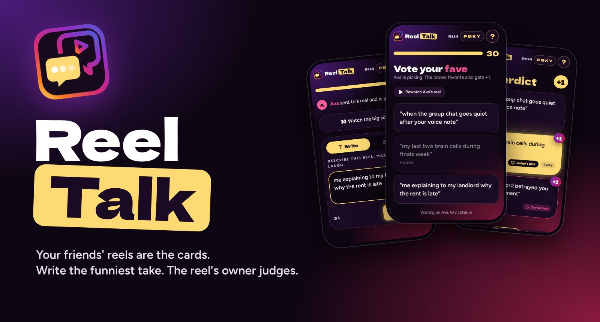
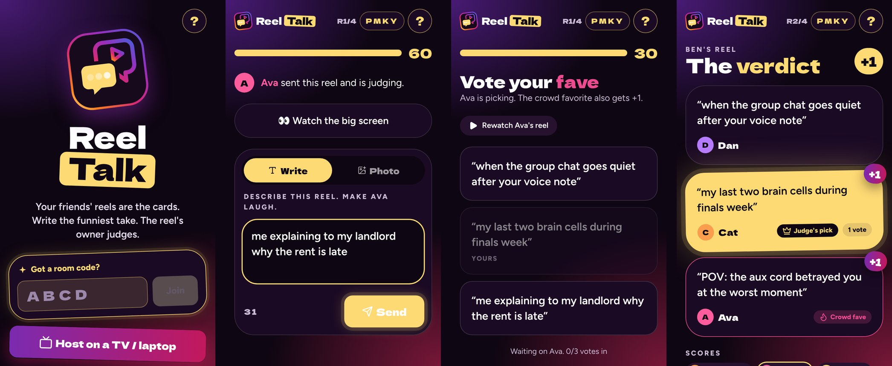
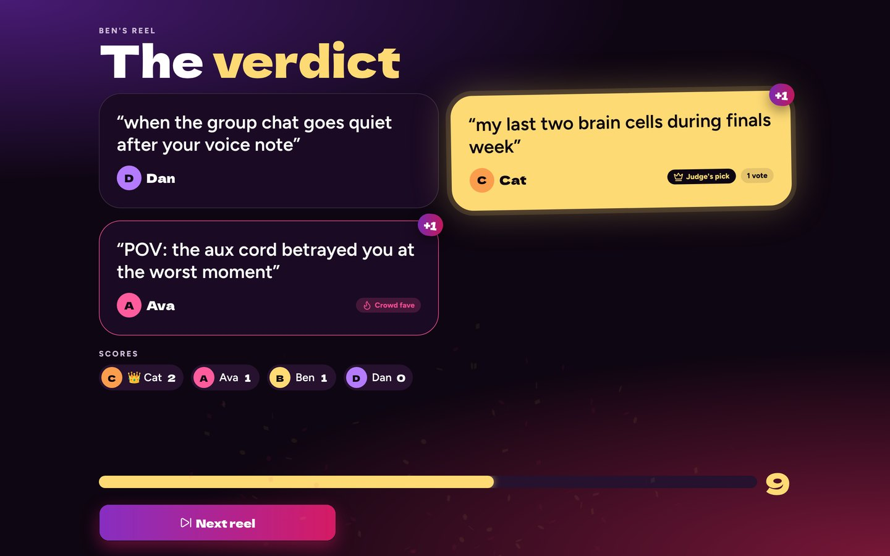

<p align="center">
  
</p>

<p align="center">
  <a href="https://reeltalk.netanelbie.workers.dev"></a>
</p>

<p align="center">
  
  
  
</p>

**Reel Talk** is a party game: Cards Against Humanity, but the black card is a friend's Instagram reel. A reel plays, everyone writes the funniest take on it, and **the person who sent the reel judges**. The crowd votes for a bonus point. Most points after the last reel wins.

No app, no account. Open the link, scan a QR code, play.

## How a round works

1. **Drop your reels.** Everyone adds a few reels that make them laugh (paste the link).
2. **A reel plays.** Everyone except its sender writes a take: type it, or add a photo.
3. **The sender judges.** They pick their favorite take. Everyone else votes at the same time, and the judge can't see the votes.
4. **Reveal.** Points land, the next reel starts, and the next person judges.

<p align="center">
  
</p>

## Get your reels ready

The game is only as good as the reels. A few minutes of prep before the party makes it:

- **Saved:** bookmark reels you love in the days before. When it's time, open your Saved tab and pick from there.
- **DMs:** scroll your group chats for the reels your friends sent you. Those are usually the best ones.
- **Copy the link:** in Instagram tap **Share**, then **Copy link**, then come back and hit **Paste**.
- **Public accounts only**, and no duplicates: private or repeated reels are rejected.
- **Original audio plays best.** Reels with a licensed song may not play on the TV, but everyone can still tap **Watch the reel** to open it in Instagram.

Stuck? Every screen has a **?** button with these rules.

## Ways to play

| Mode | What you need | How it works |
|---|---|---|
| **Party** | A TV or laptop, plus phones | The big screen plays the reel and shows the reveals. Phones scan a QR code and act as controllers. |
| **Bus** | Phones only (bring headphones) | No screen. Each phone opens the reel in Instagram, then comes back to answer. |
| **Solo test** | One laptop | `/solo` shows the TV and 3 or 4 phones in one window, so one person can play every seat. Any tab can also take a seat with `?seat=p1`. |

<p align="center">
  
</p>

## Scoring

| Award | Points |
|---|---|
| Judge's pick | +1 |
| Crowd favorite (the take with the most votes, **4 or more players**; ties share it) | +1 |

A take can win both for +2. With 3 players only the judge's pick scores.

## Develop

```bash
cd app && npm install
npm run build          # app + inlined assets + worker typecheck
npm run dev:worker     # http://localhost:8787 (Durable Objects run locally; runs from the repo root)
```

### Test before a playtest

```bash
cd app && npm run e2e  # Playwright: full party + bus games, refresh, leaver, late joiner
```

Screenshots of every phase land in `app/e2e-screens/`. First time on a new machine: `npx playwright install chromium`.
Reels in tests are fake (`E2Etest…` codes, only accepted when the local server runs with `E2E_FAKE_REELS=1`), so real Instagram playback still needs a human check.

### Icons

The tab icon, iOS home-screen icon, web manifest and share image all come from one logo mark. To regenerate the icons after changing it:

```bash
cd app && node scripts/make-icons.mjs
```

### Deploy

Pushing to `main` deploys automatically (Cloudflare's GitHub build runs `npx wrangler deploy` from the repo root). To deploy by hand:

```bash
cd app && npm run deploy
```

That needs a Cloudflare API token (Workers edit) and `CLOUDFLARE_ACCOUNT_ID`.

## How it's built

- **Server:** one Cloudflare Worker and one Durable Object (SQLite) per room. WebSockets with hibernation. The server owns the phase, timers and scores.
- **Client:** Vite, React, Tailwind, shadcn/ui, Motion.
- **Reels:** checked server-side with Instagram's tokenless oEmbed and embed page, then cached.
- **Assets:** the built frontend is inlined into the Worker script (`app/scripts/bundle-assets.mjs`), so one deploy ships everything.

```
app/worker/game.ts     pure game rules (phases, scoring, round-robin judging)
app/worker/index.ts    Worker routes, reel validation, Room Durable Object
app/shared/types.ts    protocol shared by server and client
app/src/screens/       phone screens; Display.tsx is the TV screen
app/src/components/    shared UI (logo, buttons, help sheet, reel card)
app/public/            icons, manifest, share image
team/                  how the AI chats and the owner hand work off (STATUS, DECISIONS, roles)
docs/                  images used in this README
```

## Project docs

- [ROADMAP.md](ROADMAP.md): what is next
- [PLAN.md](PLAN.md): MVP scope and rules
- [SPIKE.md](SPIKE.md): the reel-playback findings that shaped the design
- [team/STATUS.md](team/STATUS.md): where things stand right now

---

<sub>Reel Talk is an independent project. It is not affiliated with, endorsed by or sponsored by Instagram or Meta. Reels belong to their creators and are only embedded or linked, never copied or stored.</sub>
